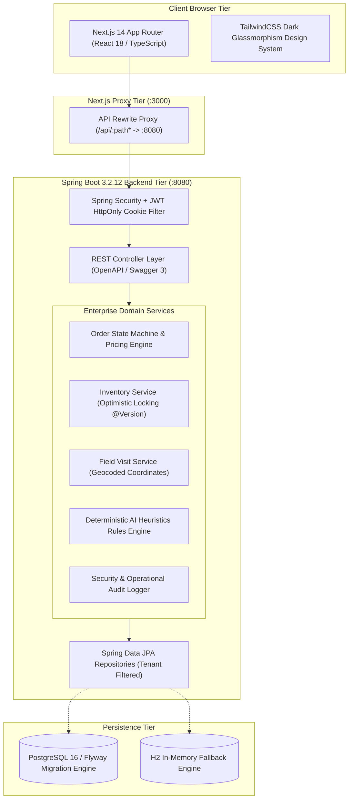
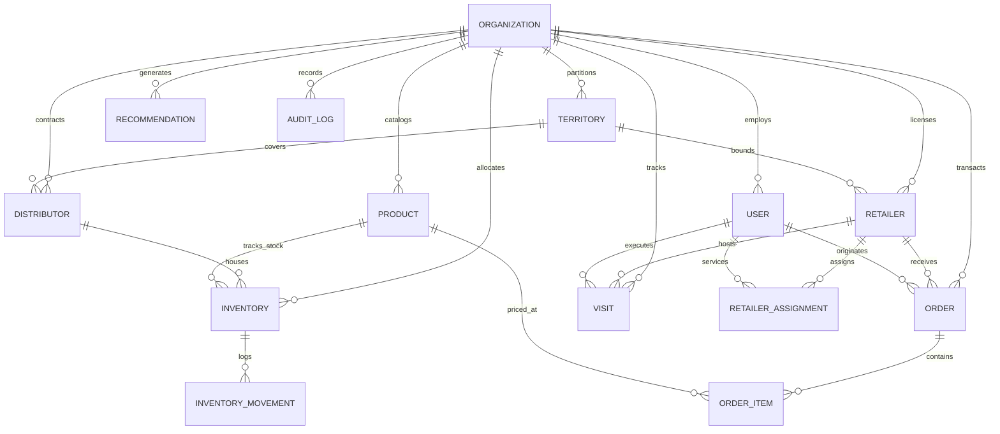

<div align="center">

# ⚡ RetailFlow AI
### *Next-Generation Intelligent Retail Sales & Distribution Execution Platform*

[](https://spring.io/projects/spring-boot)
[](https://openjdk.org/)
[](https://nextjs.org/)
[](https://www.typescriptlang.org/)
[](https://www.postgresql.org/)
[](https://www.docker.com/)
[](https://tailwindcss.com/)
[](https://flywaydb.org/)

<p align="center">
  <strong>Eliminate inventory over-allocation • Verify physical store visits via GPS • Automate order state machines • Surface algorithmic replenishment recommendations</strong>
</p>

[Quickstart](#-quickstart--running-locally) •
[Architecture](#-system-architecture) •
[Core Features](#-core-capabilities--technical-highlights) •
[Demo Credentials](#-pre-seeded-demo-accounts) •
[API Catalog](#-rest-api-catalog) •
[Docker Deployment](#-docker-compose-deployment) •
[Automated Tests](#-testing--qa-verification)

</div>

---

## 📖 Executive Summary

In high-velocity FMCG, consumer goods, and wholesale retail, legacy distribution pipelines suffer from three chronic points of failure:
1. **Phantom Inventory & Stockouts**: Orders placed against already-committed warehouse quantities without concurrency control.
2. **Unverified Field Execution**: Sales reps reporting store visits without physical geolocation verification.
3. **Reactive Reordering**: Replenishment orders placed only after store shelves are empty, losing days of revenue.

**RetailFlow AI** solves these challenges with a production-grade, modular monolith architecture. Featuring **JPA Optimistic Concurrency Control**, **client-side UUID idempotency**, **geocoded store check-ins**, and a **deterministic AI rules engine**, RetailFlow AI provides unified real-time visibility from brand manufacturers and regional 3PL hubs down to individual retail stores.

---

## 🏛️ System Architecture

RetailFlow AI uses a high-performance **Modular Layered Monolith** pattern with multi-tenant data boundaries enforced by tenant discriminators.



---

## 📊 Entity-Relationship (ER) Domain Model



---

## 🚀 Core Capabilities & Technical Highlights

### 1. Multi-Tenant Enterprise Isolation
- **Tenant Discriminator**: Every business entity is bound to `organization_id`.
- **Contextual Query Filtering**: Security principals automatically filter database queries by organization ID, preventing cross-tenant data leakage.

### 2. Optimistic Concurrency Control for Inventory
- **Zero Over-Allocation**: Warehouse stock adjustments utilize JPA `@Version private Long version;` optimistic locking.
- **Concurrent Conflict Detection**: If concurrent orders attempt to reserve the same stock, Spring Boot detects the mutation conflict, rolls back the transaction, and returns a clear `CONCURRENT_UPDATE_CONFLICT`.
- **Movement Audit Trail**: Every deduction, inbound restock (`STOCK_IN`), write-off (`STOCK_OUT`), or cycle audit (`ADJUSTMENT`) logs to the immutable `InventoryMovement` ledger.

### 3. Idempotent Order Finite State Machine
- **Strict State Machine**:
  $$\text{CREATED} \longrightarrow \text{CONFIRMED} \longrightarrow \text{PROCESSING} \longrightarrow \text{SHIPPED} \longrightarrow \text{DELIVERED}$$
- **Atomic Stock Deduction**: Stock is deducted upon order creation and safely restored if an order is rejected or cancelled.
- **Idempotency Protection**: Accepts an `Idempotency-Key` header with client-generated UUIDs. Replay requests return the original response without duplicate inventory deduction or duplicate charges.

### 4. Geocoded GPS Field Sales Check-Ins
- **Browser Geolocation Integration**: Field reps record physical store check-ins using HTML5 Geolocation API (`latitude`, `longitude`).
- **Audit Outcomes**: Check-in and check-out timestamps are tracked alongside structured outcomes: *Order Taken*, *Shelf Restocked*, *Product Demo Conducted*, and *Follow-up Scheduled*.

### 5. Deterministic AI Heuristics Engine
- Evaluates operational data against 5 analytical rules:
  - 🚨 **`LOW_STOCK`**: Identifies inventory falling below custom threshold buffers.
  - 📉 **`DECLINING_ORDERS`**: Detects retail stores whose order volume has dropped over successive cycles.
  - 📍 **`UNVISITED_RETAILER`**: Highlights accounts without a rep visit within the prescribed servicing window.
  - 🛒 **`REORDER_SUGGESTION`**: Calculates sales run-rate and recommends replenishment quantities before stockouts occur.
  - 📦 **`FREQUENTLY_BOUGHT_TOGETHER`**: Identifies SKU co-purchase patterns for promotional bundling.

### 6. Role-Based Access Control (RBAC) & Stateless Security
- **JWT in HttpOnly Cookies**: Token is issued in a secure `HttpOnly; SameSite=Lax; Path=/` cookie, mitigating XSS risks.
- **SHA-256 HMAC-SHA256 Derivation**: Key derivation supports both raw Base64 and SHA-256 digested passphrases.
- **Three Core Roles**:
  - `ADMIN`: Complete org oversight, SKU pricing, territory zones, and user provisioning.
  - `SALES_REP`: Geocoded store check-ins, sales orders, territory visits.
  - `DISTRIBUTOR`: Warehouse stock adjustments, logistics, shipments, dispatch.

---

## 🔑 Pre-Seeded Demo Accounts

The platform includes deterministic seed data out-of-the-box. You can sign in immediately using any role:

| Role | Email Address | Password | Permissions & Scope |
| :--- | :--- | :--- | :--- |
| **HQ Admin** | `admin@retailflow.com` | `Password123!` | Master SKUs, warehouse allocations, user RBAC, territory zones, audit logs |
| **Sales Rep** | `sales.rep@retailflow.com` | `Password123!` | Geocoded store visits, check-ins, sales order creation |
| **Distributor** | `distributor@retailflow.com` | `Password123!` | Warehouse inventory adjustment, fulfillment, shipments |

> **Tip:** The Login page ([/login](file:///e:/14.09.2026%20ganesh%20chaturthi/Technology/Projects/RetailFlow%20AI/frontend/src/app/login/page.tsx)) and Landing page ([/](file:///e:/14.09.2026%20ganesh%20chaturthi/Technology/Projects/RetailFlow%20AI/frontend/src/app/page.tsx)) include **1-click auto-fill buttons** for each demo role.

---

## 🖥️ Frontend Tour & Navigation

The frontend is built with Next.js 14 App Router, TypeScript, and a responsive dark-mode glassmorphic interface:

| Page Route | Description | Highlights |
| :--- | :--- | :--- |
| **`/`** | Public Landing & Demo Launcher | System metrics, feature showcase, 1-click sandbox access |
| **`/login`** | Authentication Portal | Auto-fill role chips, show/hide password, error banners |
| **`/register`** | Tenant Onboarding | Auto-generates organization slug, provisions initial admin |
| **`/dashboard`** | Command Center | KPI stat cards, sales trend bar chart, order status pipeline |
| **`/dashboard/orders`** | Order Management | Status tabs, multi-item line builder, idempotency keys, state machine transitions |
| **`/dashboard/retailers`** | Store Directory | Store cards, territory filters, field sales rep assignment modal |
| **`/dashboard/products`** | Product Catalog | Category filter pills, packaging units, wholesale pricing |
| **`/dashboard/inventory`** | Inventory & Ledger | Dual tabs (Stock Levels vs Movements Ledger), low-stock alert banner, adjustment modal |
| **`/dashboard/visits`** | Field Visits | GPS geolocation verification, check-in timestamps, visit outcome logging |
| **`/dashboard/territories`**| Territory Coverage | Regional boundaries, store clustering, territory CRUD |
| **`/dashboard/distributors`**| 3PL Hubs | Warehouse locations, dispatch contacts, logistics partners |
| **`/dashboard/recommendations`**| AI Insights | Priority badges, prescribed actions, one-click completion, re-evaluation trigger |
| **`/dashboard/users`** | Team & RBAC | Avatar initials, role filters, user provisioning modal |
| **`/dashboard/settings`** | Org & Telemetry | Organization profile editor, Spring Boot Actuator diagnostics, immutable audit logs |

---

## 💻 Quickstart — Running Locally

### Prerequisites
- **Java 17+** (OpenJDK 17 recommended)
- **Node.js 18+** (Node 22 LTS recommended)
- **Git**

### Step 1: Start the Spring Boot Backend

```powershell
# Navigate to backend directory
cd backend

# Option A: Zero-configuration in-memory H2 database (No external database needed!)
.\mvnw.cmd spring-boot:run "-Dspring-boot.run.profiles=h2"

# Option B: Run with PostgreSQL (after starting PostgreSQL on localhost:5432)
.\mvnw.cmd spring-boot:run
```

- API Base URL: `http://localhost:8080/api/v1`
- Swagger / OpenAPI Docs: `http://localhost:8080/swagger-ui/index.html`
- Health Endpoint: `http://localhost:8080/actuator/health`

### Step 2: Start the Next.js Frontend

```powershell
# In a separate terminal, navigate to frontend directory
cd frontend

# Install dependencies (if not already installed)
npm install

# Start Next.js development server
npm run dev
```

- Web Dashboard URL: `http://localhost:3000`

---

## 🐳 Docker Compose Deployment

Deploy the entire production stack (PostgreSQL 16, Spring Boot API, Next.js Web App) with a single command:

```bash
docker-compose up --build
```

### Services Deployed:
| Container | Port | Service |
| :--- | :--- | :--- |
| `retailflow-frontend` | `3000` | Next.js 14 Production Web App |
| `retailflow-backend` | `8080` | Spring Boot 3.2 REST API |
| `retailflow-postgres` | `5432` | PostgreSQL 16 Database Engine |

---

## 🧪 Testing & QA Verification

### Backend Automated Test Suite
Run the test suites with the Maven wrapper:

```powershell
cd backend
.\mvnw.cmd test "-Dspring.profiles.active=test"
```

**Results: 10/10 Tests Passing (0 Failures, 0 Errors)**
- `AuthControllerIntegrationTest`: Authentication, JWT issuance, cookie handling.
- `OrderApiIntegrationTest`: Order creation with server-calculated totals and idempotency replay.
- `OrderStateMachineTest`: State transition validation and illegal transition rejection.
- `OrderCalculationTest`: Currency calculations with zero floating-point rounding errors.
- `InventoryServiceTest`: Concurrent inventory adjustments and low-stock threshold triggers.
- `JwtServiceTest`: Token signature verification, claim extraction, and expiration enforcement.

### Frontend Production Build Verification
```powershell
cd frontend
npm run build
```
- **17/17 routes compiled cleanly** with zero TypeScript errors and zero lint warnings.

---

## 📋 REST API Catalog

| Endpoint | Method | Role | Description |
| :--- | :--- | :--- | :--- |
| `/api/v1/auth/login` | `POST` | Public | Authenticates credentials and sets secure JWT cookie |
| `/api/v1/auth/register` | `POST` | Public | Registers a new enterprise organization and admin |
| `/api/v1/auth/me` | `GET` | Authenticated | Fetches authenticated user profile and org context |
| `/api/v1/analytics/dashboard` | `GET` | Authenticated | Aggregated KPIs, revenue metrics, top SKUs, sales trend |
| `/api/v1/orders` | `GET` | Authenticated | Paginated sales orders with status/distributor filtering |
| `/api/v1/orders` | `POST` | Admin / Sales Rep | Creates order with server pricing and inventory deduction |
| `/api/v1/orders/{id}/status` | `PATCH` | Authenticated | Advances order state machine (Confirmed, Shipped, etc.) |
| `/api/v1/retailers` | `GET` / `POST` | Authenticated | Retail store directory & new store creation |
| `/api/v1/retailers/{id}/assign/{userId}` | `POST` | Admin | Assigns field sales representative to store |
| `/api/v1/products` | `GET` / `POST` | Authenticated | Master SKU catalog management |
| `/api/v1/inventory` | `GET` | Authenticated | Stock levels with low-stock filter |
| `/api/v1/inventory/adjust` | `POST` | Admin / Distributor | Adjusts warehouse inventory stock with audit record |
| `/api/v1/inventory/movements` | `GET` | Authenticated | Immutable inventory movement audit ledger |
| `/api/v1/visits/check-in` | `POST` | Admin / Sales Rep | Records store visit with geocoded GPS coordinates |
| `/api/v1/visits/{id}/complete` | `POST` | Admin / Sales Rep | Records visit outcome and notes |
| `/api/v1/recommendations` | `GET` | Authenticated | Active AI sales & stock recommendations |
| `/api/v1/recommendations/refresh` | `POST` | Authenticated | Triggers rule evaluation to regenerate insights |
| `/api/v1/users` | `GET` / `POST` | Admin | Team management and role assignment |
| `/api/v1/organizations/current` | `GET` / `PUT` | Authenticated / Admin | Organization profile settings |
| `/api/v1/audit-logs` | `GET` | Admin | Security and mutation audit logs |

---

## 📁 Repository Structure

```
RetailFlow AI/
├── backend/                        # Spring Boot 3.2.12 (Java 17 LTS)
│   ├── src/main/java/com/retailflow/
│   │   ├── analytics/              # Dashboard KPI aggregations & trend metrics
│   │   ├── audit/                  # Security & mutation audit logging
│   │   ├── auth/                   # Authentication, registration & cookies
│   │   ├── common/                 # Global exception handlers, responses & DTOs
│   │   ├── config/                 # Security, CORS, Swagger & DataSeeder
│   │   ├── distributor/            # Logistics hubs & 3PL partners
│   │   ├── inventory/              # Optimistic locking stock & movement ledger
│   │   ├── order/                  # Finite state machine & idempotent order engine
│   │   ├── organization/           # Multi-tenant organization profile management
│   │   ├── product/                # Master SKU catalog & pricing tiers
│   │   ├── recommendation/         # Deterministic AI heuristics engine
│   │   ├── retailer/               # Retail store accounts & rep assignments
│   │   ├── security/               # JWT token service, filter & UserPrincipal
│   │   ├── territory/              # Regional distribution zones & coverage
│   │   ├── user/                   # Team directory & RBAC access control
│   │   └── visit/                  # Geocoded field visits & store check-ins
│   ├── src/main/resources/
│   │   ├── application.properties  # Production PostgreSQL configuration
│   │   ├── application-h2.properties # In-memory H2 configuration
│   │   └── db/migration/           # Flyway DDL database schemas
│   ├── src/test/                   # Unit & Integration test suites
│   ├── Dockerfile                  # Multi-stage Temurin 17 JRE Docker image
│   └── pom.xml                     # Maven project configuration
├── frontend/                       # Next.js 14 App Router (TypeScript / Tailwind)
│   ├── src/app/                    # 14 complete production pages & layouts
│   ├── src/components/layout/      # Sidebar, dashboard shell & navigation
│   ├── src/components/ui/          # StatusBadge, DataTable, Modal, StatCard
│   ├── src/contexts/               # Context-based AuthProvider
│   ├── src/lib/api.ts              # Typed API client matching all backend routes
│   ├── src/types/index.ts          # Comprehensive TypeScript domain interfaces
│   ├── Dockerfile                  # Multi-stage Node 22 Alpine Docker image
│   └── package.json                # Dependencies: lucide-react, tailwindcss
├── scripts/                        # Automated PowerShell launch scripts
│   ├── run-backend.ps1             # Launches Spring Boot API
│   └── run-frontend.ps1            # Launches Next.js dev server
├── docker-compose.yml              # PostgreSQL + Backend + Frontend orchestration
├── .env.example                    # Environment variable template
└── README.md                       # Comprehensive platform documentation
```

---

## 📄 License & Contributing

Distributed under the **MIT License**. Built with passion for enterprise retail distribution intelligence.

<div align="center">
  <sub>RetailFlow AI • Engineered with Spring Boot 3.2, Next.js 14, and PostgreSQL 16</sub>
</div>